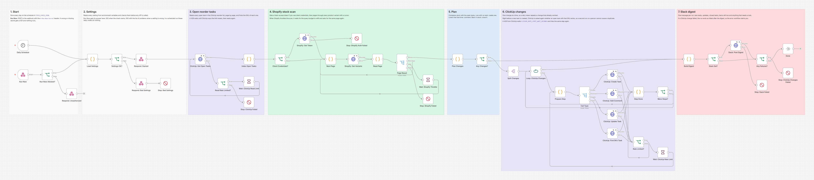
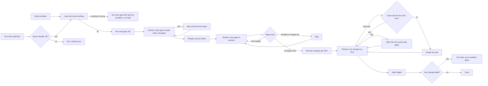

# Shopify Low Stock to ClickUp Reorder Tasks

A daily stock check that reads every product variant in Shopify, opens a ClickUp reorder task for anything at or below its reorder point, keeps those tasks up to date as stock changes, closes them when stock is back, and posts one Slack digest per run. Built with n8n.



## The problem

Most small stores notice low stock when a customer cannot buy something. By then the reorder is late, because the supplier still needs two or three weeks. Someone is supposed to check the stock report every morning, but it is easy to skip a day, and when they do spot a low item there is no shared record of who ordered what, from which supplier, and when it should arrive. Reminders that do exist tend to repeat every day for the same item until people stop reading them.

## What this does

1. **Checks stock every day**, on the schedule you set, or right away when you call the Run Now webhook.
2. **Reads every variant in Shopify**, page by page, with its SKU, stock on hand and reorder point. The reorder point comes from a variant metafield, so each item can have its own. Variants without tracked inventory or without a SKU are skipped and counted.
3. **Opens one ClickUp task per low SKU**, with the stock numbers, the supplier and their email, a link to the variant in Shopify, a priority by how bad it is (out of stock is urgent) and a due date based on the supplier's lead time.
4. **Does not open a second task for the same SKU.** It reads the open tasks in the reorder list first, and asks ClickUp once more right before it creates a task, in case a second run or a person made one in the meantime. If stock drops further, it adds a comment to the existing task (and raises the priority if needed) instead of creating a new one.
5. **Closes the task when stock is back** above the reorder point, with a short comment saying why.
6. **Posts one Slack digest per run:** new tasks, updated tasks, closed tasks, items still low, and anything that needs a person to look at it.
7. **Fails safely.** It waits and retries when Shopify throttles or ClickUp rate limits, makes one ClickUp change at a time so a retry never repeats a change that already worked, and ends the run as failed (so the error workflow alerts you) when something could not be done.

## How it works



The open ClickUp tasks are read before Shopify, so the workflow knows which SKUs already have a task. Each task is matched to its SKU through a SKU custom field, or through the task name (`Reorder SKU: Product`) for tasks people made by hand.

Shopify's GraphQL API gives every request a cost and refills a budget every second. When Shopify answers `THROTTLED`, the workflow works out how long the budget needs to refill, waits that long and asks for the same page again. When the budget left after a page is too small for the next one, it pauses before asking. Each page is stored once and the plan is made after the last page, so a big catalog is not copied through every pass of the loop.

Right before a new task is created, the workflow asks ClickUp for open tasks whose SKU field is exactly that SKU (the `custom_fields` filter with the `==` operator, ClickUp's exact match for text fields). If one shows up, for example because a second run or a person made it after this run read the list, no task is created and the digest says so under "Needs a look". This look-up needs the SKU custom field (`CLICKUP_SKU_FIELD_ID`). If it fails, the task is not created in that run, so a failed look-up can never lead to a duplicate.

To tell whether stock "dropped further", the workflow remembers the stock number it last told the team about for each task (in the workflow's static data). If that is missing, for example after the workflow was imported again, it reads the `On hand:` line in the task description.

## Workflow at a glance

| Step | Nodes | What it does |
|---|---|---|
| Start | Daily Schedule, Run Now, Run Now Allowed?, Respond: Unauthorized | Runs on `STOCK_CHECK_CRON`, or on a POST with the right `X-Run-Now-Secret` header. A wrong or missing secret gets a 401 |
| 1 | Load Settings, Settings OK?, Respond: Started, Respond: Bad Settings, Stop: Bad Settings | Reads and checks every setting before any API is called. Run Now gets 202 when the check starts, or 500 with the list of problems. Secrets stay in `$env` and are never copied into the run data |
| 2 | ClickUp: Get Open Tasks, Read Rate Limited?, Wait: ClickUp Read Limit, Stop: ClickUp Failed | Reads every open task in the reorder list, 100 per page, until ClickUp says it was the last page. After a 429 it waits until the `X-RateLimit-Reset` time and reads again (up to 3 times) |
| 3 | Index Open Tasks | Finds the SKU of each task and keeps the oldest task per SKU as the one to update |
| 4 | Client Credentials?, Shopify: Get Token, Stop: Shopify Auth Failed | Gets a fresh access token for apps made in the Shopify Dev Dashboard. Older custom apps use their stored token |
| 5 | Next Page, Shopify: Get Variants, Read Page, Page Result, Wait: Shopify Throttle, Stop: Shopify Failed | Pages through all variants with a cursor, waits when Shopify throttles, and stops with a clear message on errors |
| 6 | Plan Changes, Any Changes? | Adds up stock per SKU and decides, per SKU: new task, comment, raise priority, close, or nothing |
| 7 | Split Changes, Loop: ClickUp Changes, Prepare Step, Call Type | Works through the changes one at a time. A change can have two steps, for example close and then comment, or look up and then create |
| 8 | ClickUp: Find SKU Task, ClickUp: Create Task, ClickUp: Add Comment, ClickUp: Update Task | The ClickUp API v2 calls, each retried 3 times. The look-up runs right before every create |
| 9 | Rate Limited?, Wait: ClickUp Rate Limit | After a 429, waits `CLICKUP_RATE_LIMIT_WAIT_SECONDS` and tries the same step again (up to 3 times) |
| 10 | Step Done, More Steps? | Records the result, remembers the stock number the team was told about, and moves to the next step or change |
| 11 | Build Digest, Slack Set?, Slack: Post Digest, Stop: Slack Failed | Writes and posts the digest (Slack is optional) |
| 12 | Any Failures?, Stop: ClickUp Changes Failed, Done | Ends the run as failed if any ClickUp change failed, so the error workflow sends an alert |

## Reorder rules

| Situation | What happens in ClickUp |
|---|---|
| On hand is at or below the reorder point, no open task | A new task |
| Low, no open task when the run started, but one exists right before the create | No new task. Listed under "Needs a look" |
| Low, there is an open task, and stock is lower than the number the team last saw | A comment with the new number. The priority is raised if the new severity is higher |
| Low, open task, stock the same or higher | Nothing. Listed under "Still low" |
| Back above the reorder point, open task | The task is closed (status `CLICKUP_CLOSED_STATUS`), then a comment explains why |
| Open task, but the SKU was not found in the scan | Left alone and listed under "Needs a look" |
| Two open tasks for one SKU | The oldest one is kept up to date, the others are listed under "Needs a look" |

- **Reorder point:** the variant metafield set in `REORDER_POINT_METAFIELD` (default `custom.reorder_point`), a whole number. Without it, `DEFAULT_REORDER_POINT`. A broken value (like `abc`) falls back to the default and is listed under "Needs a look".
- **Priority:** urgent when out of stock (0 or less), high at or below half the reorder point, normal otherwise. The workflow only ever raises a priority, never lowers one someone set.
- **Supplier:** looked up in `SUPPLIERS_JSON` by exact SKU first, then the longest SKU prefix ending in `*`, then the Shopify vendor name, then `default`.
- **Due date:** today plus the supplier's `leadTimeDays` (or `DEFAULT_LEAD_TIME_DAYS`). It is the day new stock should arrive if it is ordered today, so an overdue task means the delivery is late.
- **Same SKU on several variants:** their stock is added up before comparing it with the reorder point.

## What the team gets

A Slack digest like this one, taken from the final test run (all data made up):

```
*Low stock check*, Oct 21, 2026 4:12 AM (run now)
Checked 13 variants on 5 pages: 7 low, 1 back in stock. Skipped 1 not tracked, 1 without a SKU.

*New reorder tasks (3)*
• MUG-BLK-12 Stoneware Mug (Black / 12 oz): 0 on hand, reorder point 12. Urgent priority, Harbor Ceramics Co., due Nov 11. Open task
• MUG-WHT-12 Stoneware Mug (White / 12 oz): 5 on hand, reorder point 10. High priority, Harbor Ceramics Co., due Nov 11. Open task
• PLANT-POT-S Terracotta Planter (Small): 4 on hand, reorder point 10. High priority, Greenline Pottery, due Oct 28. Open task

*Updated (2)*
• CANDLE-CED Cedar Candle: dropped from 9 to 7 on hand (reorder point 8). Open task
• CANDLE-SND Sandalwood Candle: priority raised to high (2 on hand, reorder point 10). Open task

*Restocked and closed (1)*
• TOWEL-GRY Bath Towel (Gray): 40 on hand, above the reorder point of 10. Open task

*Still low, no change (2)*
• RUG-JUTE Jute Rug (2 x 3 ft): 1 on hand, reorder point 6. Open task
• VASE-CLR Glass Vase (Clear): 2 on hand, reorder point 5. Open task

*Needs a look (4)*
• PLANT-POT-S: the reorder point metafield is "abc", which is not a whole number, so the default of 10 was used.
• TOWEL-WHT is used on 2 variants. Their stock was added up: 25 on hand.
• VASE-CLR has 2 open reorder tasks. The oldest one is kept up to date. Please close the others: 86b0vs201
• LAMP-BRASS has an open reorder task, but no tracked Shopify variant in this scan has that SKU. Open task
```

Every "Open task" is a link to the task in ClickUp. A new task looks like this:

```
Reorder MUG-BLK-12: Stoneware Mug (Black / 12 oz)        Urgent, due Nov 11, tag low-stock

Stock is at or below the reorder point in Shopify.

SKU: MUG-BLK-12
Product: Stoneware Mug (Black / 12 oz)
On hand: 0
Reorder point: 12
Supplier: Harbor Ceramics Co., orders@harborceramics.example.com
Lead time: 21 days. The due date is when new stock should arrive if it is ordered today.
Shopify: https://admin.shopify.com/store/driftwood-test/products/1001/variants/101
```

## Setup

**You need:** self-hosted n8n (tested on 2.19.5), a Shopify store you own, a ClickUp list for reorders and, optionally, a Slack incoming webhook.

1. In Shopify, give the workflow read access to products and inventory: either an app made in the Dev Dashboard (client ID and secret) or an older custom app's Admin API token. Optionally add a variant metafield for the reorder point.
2. In ClickUp, make a reorder list, generate a personal API token and add a Text custom field called SKU (strongly recommended: the look-up that prevents duplicates needs it).
3. Add the variables below to your n8n environment and restart n8n. The nodes read them with `$env`, so self-hosted n8n needs `N8N_BLOCK_ENV_ACCESS_IN_NODE=false`. (n8n Cloud does not allow `$env`. There, replace `$env.` with `$vars.` and create the same names under Variables.)
4. Import `workflow/shopify-low-stock-to-clickup.json` and `workflow/error-alert-slack.json`. **Activate the error alert workflow**: n8n 2.x only runs an error workflow that is active. Then choose it as the **Error Workflow** in the stock check's workflow settings.
5. Activate the stock check, then try it once with Run Now:
   `curl -X POST https://YOUR-N8N-DOMAIN/webhook/shopify-low-stock-run-now -H "X-Run-Now-Secret: YOUR-SECRET"`

Step by step, with where to click in Shopify and ClickUp: [docs/setup.md](docs/setup.md).

| Variable | Required | Where to find it |
|---|---|---|
| `SHOPIFY_STORE_DOMAIN` | yes | Your store's `.myshopify.com` address (Shopify admin → Settings → Domains), for example `your-store.myshopify.com` |
| `SHOPIFY_CLIENT_ID`, `SHOPIFY_CLIENT_SECRET` | one of the two options | Dev Dashboard (dev.shopify.com) → your app → App settings → Credentials. The workflow gets a fresh token on every run, since these tokens last 24 hours |
| `SHOPIFY_ACCESS_TOKEN` | one of the two options | Only for custom apps created in the Shopify admin before 2026 (Settings → Apps and sales channels → Develop apps → your app → API credentials). Starts with `shpat_` |
| `SHOPIFY_API_VERSION` | no | Admin API version, default `2026-10` |
| `SHOPIFY_PAGE_SIZE` | no | Variants per request, default `100`, at most `200` so a request stays under Shopify's 1,000 point limit |
| `SHOPIFY_VARIANT_QUERY` | no | Shopify search filter for the scan, default `product_status:ACTIVE`. For example `product_status:ACTIVE,DRAFT` or `vendor:'Harbor Ceramics'` |
| `REORDER_POINT_METAFIELD` | no | The variant metafield with the reorder point, as `namespace.key`, default `custom.reorder_point` |
| `DEFAULT_REORDER_POINT` | no | Used when a variant has no reorder point metafield, default `5` |
| `DEFAULT_LEAD_TIME_DAYS` | no | Used when the supplier has no lead time, default `14` |
| `SUPPLIERS_JSON` | no | Supplier names, emails and lead times, on one line (see below) |
| `CLICKUP_API_TOKEN` | yes | ClickUp → your avatar → Settings → Apps → API Token → Generate (starts with `pk_`) |
| `CLICKUP_LIST_ID` | yes | Open the reorder list in ClickUp. It is the number after `/li/` in the URL |
| `CLICKUP_SKU_FIELD_ID` | recommended | ID of a Text custom field named SKU on that list. Without it, tasks are matched by name only and there is no look-up right before a create. How to get it: [docs/setup.md](docs/setup.md#4-the-sku-custom-field) |
| `CLICKUP_ASSIGNEE_IDS` | no | ClickUp user IDs to assign new tasks to, separated by commas |
| `CLICKUP_TAG` | no | Tag for new tasks, default `low-stock`. Set `none` for no tag |
| `CLICKUP_CLOSED_STATUS` | no | Status that closes a task, default `complete`. It must exist in the list |
| `CLICKUP_RATE_LIMIT_WAIT_SECONDS` | no | Wait after a ClickUp 429 on a change, default `60` (ClickUp's limit is per minute). On the task read the workflow waits until ClickUp's `X-RateLimit-Reset` time instead, and uses this value only when that header is missing |
| `RUN_NOW_SECRET` | for Run Now | Any long random string. Send it in the `X-Run-Now-Secret` header. Without it, Run Now refuses every call; the schedule still runs |
| `STOCK_CHECK_CRON` | no | When the check runs, default `0 7 * * *` (7:00 every day, in n8n's time zone) |
| `SLACK_WEBHOOK_URL` | no | A Slack incoming webhook for the digest and the error alerts. Leave it empty to skip Slack |

`SUPPLIERS_JSON` keys are an exact SKU, a SKU prefix ending in `*`, a Shopify vendor name, or `default`:

```json
{"Harbor Ceramics": {"name": "Harbor Ceramics Co.", "email": "orders@harborceramics.example.com", "leadTimeDays": 21}, "PLANT-*": {"name": "Greenline Pottery", "email": "sales@greenline.example.com", "leadTimeDays": 7}, "default": {"name": "Driftwood Wholesale", "email": "buying@driftwood-wholesale.example.com"}}
```

## Testing

The workflow was tested end to end on n8n 2.19.5 against **mock Shopify, ClickUp and Slack APIs**, so no real store or workspace was touched. The mocks answer with the real response shapes (GraphQL `data`, `errors` and `extensions.cost`, ClickUp task objects with `last_page`, `err` and `ECODE`) and reject what the real APIs would reject: a missing or wrong token, the wrong content type, missing required fields, undeclared GraphQL variables or missing fields, a page size above 250, a malformed `custom_fields` filter, a status that does not exist in the list. The test catalog has 13 variants on 5 Shopify pages, and the ClickUp list has 100 unrelated tasks in front of the reorder tasks, so both APIs are read over more than one page.

All 58 checks across 21 scenarios pass:

| Scenario | Result |
|---|---|
| Settings mistake (no list ID, broken `SUPPLIERS_JSON`) | Run Now gets 500 with both problems listed. Stopped before any API call |
| Slack not set | Tasks still created and updated, nothing posted, run ends normally |
| Run Now without a secret, with a wrong secret, and with `RUN_NOW_SECRET` not set | 401, nothing runs |
| Daily schedule, older custom app token | The schedule ran the full check with the stored token and posted the digest |
| First run | One token request, cursor paging over 5 pages, a throttled page asked again after the 3 seconds the budget needed, a pause when the budget ran low, ClickUp read over 2 pages, a look-up right before each of the 3 new tasks, the right priority, due date, supplier, assignee, tag and SKU field, 1 drop comment, 1 task closed, 1 priority raised, 7 writes in total, digest with every section, no secret anywhere in the run data |
| Second run, no stock change | No writes at all, 7 items listed as still low |
| Stock drops, ClickUp 429 and Shopify 429 | Both retried and waited; one comment, not four; priority raised to urgent at 0 on hand; the drop measured from the number saved in the last run; a restocked task closed |
| ClickUp fails one create (500) | Tried 3 times, the next change still made, failure listed in the digest, run failed after the digest, error alert posted, no secret in the error items |
| ClickUp is back | The missing task created once, nothing doubled, exactly one open task per low SKU |
| A task appears in ClickUp while the run is going | The look-up found it, so no second task. The other low SKU still got its task. The digest says why |
| ClickUp rate limits the task read | Waited the 4 seconds ClickUp's reset header gave (not the 2 second fallback), read every page, changed nothing |
| ClickUp keeps rate limiting the task read | Gave up after 3 waits with a clear message, Shopify never called, alert posted |
| Shopify denies access, keeps throttling, is down (503), refuses the client credentials | Stopped with a clear message, no ClickUp change, error alert posted |
| ClickUp refuses the token while reading tasks | Stopped before Shopify is called, error alert posted |
| Slack is down | Digest retried 3 times, run failed so it shows up as an error |
| ClickUp keeps rate limiting a change | 3 waits, then the change is given up for this run, listed in the digest with the reason, run failed, alert posted |

Full results and the requests the workflow sent: [docs/test-report.md](docs/test-report.md). Run the same tests yourself with [tests/e2e_mock_test.py](tests/e2e_mock_test.py) (about 4 minutes, one of them waiting for the schedule). What testing and review found and fixed is in [CHANGELOG.md](CHANGELOG.md).

## What it handles when things go wrong

| Problem | What happens |
|---|---|
| A setting is missing or wrong | The run stops before calling any API. Run Now answers 500 with the list of problems, and the alert names every one |
| Someone calls Run Now without the secret | 401, nothing runs. No alert, so a bot scanning URLs cannot flood Slack |
| Shopify throttles (`THROTTLED`) or answers 429 | Waits until the query budget has refilled (after a 429: 2, then 4, then 8 seconds and so on) and asks for the same page again, up to 5 times, then stops with an alert |
| Shopify is down, or a scope is missing | 3 tries, then the run stops with Shopify's message. Nothing is changed in ClickUp, so a half scan never closes a task |
| ClickUp answers 429 while the open tasks are read | 3 quick tries, then a wait until ClickUp's `X-RateLimit-Reset` time (at most 2 minutes) and the read again, up to 3 times, then a stop with an alert |
| ClickUp answers 429 to a change | 3 quick tries, then a wait of `CLICKUP_RATE_LIMIT_WAIT_SECONDS` and the same step again, up to 3 times |
| A ClickUp change fails for good | The other changes still go through. The digest lists it, the run ends as failed and the error workflow alerts. The next run tries it again |
| Another run or a person opens a task for a SKU during the run | The look-up right before the create finds it, so no second task is made |
| Close works but the comment fails | The task stays closed and the digest says the comment is missing. Closing first means a retry never doubles the comment |
| A task was made by hand | It is matched by its SKU field or its name and kept up to date like the others |
| Someone duplicated a task | The oldest one is updated, the copies are listed for review |
| A SKU disappears from Shopify, or stops being tracked | Its task is left open and listed under "Needs a look" |
| Slack is down | 3 tries, then the run is marked as failed. The ClickUp changes are already made |

## Limitations and next steps

- The look-up right before a create makes duplicates very unlikely, but two runs that reach the same create within a second of each other could still both create a task, and the look-up needs the SKU custom field. Avoid calling Run Now at the scheduled time.
- The stock number the team last saw is kept in n8n's workflow static data, saved as one block per workflow when a run ends. If two runs overlap, the one that ends last wins. The workflow then falls back to the `On hand:` line in the task description, so the worst case is a missed or repeated drop comment, not a duplicate task. Postgres or an n8n data table would fix it.
- If ClickUp creates a task but the answer is lost on the way back, the node's own retry can create a second task. The next run spots the pair and lists it under "Needs a look".
- After a ClickUp 429 on a change the wait is a fixed number of seconds. For single requests n8n's error output does not keep the `X-RateLimit-Reset` header (it does for the paged task read, which uses it).
- Stock is the total across all locations (`inventoryQuantity`). Reordering per warehouse would need `inventoryLevels`.
- There is no buffer above the reorder point, so stock that moves back and forth around it opens and closes tasks. A restock buffer would fix that.
- The task does not suggest an order quantity. Sales velocity from recent orders would allow "days of cover" and a suggested quantity.
- Tokens are read from environment variables. For production, move them into n8n credentials. The client credentials token (valid 24 hours) is visible in the run data of the token node.
- Above roughly 50,000 variants, Shopify's bulk operations API would be a better fit than paging.

## About

Built by **Romiel Inolino**, AI and CRM Automation Specialist working with GoHighLevel, Monday.com, ClickUp, n8n, Make and Zapier.
Portfolio and case studies: [romielwillautomate.dev](https://romielwillautomate.dev)

This repository is a portfolio implementation. Credentials, API keys and customer data are not included, and all test data is made up.
